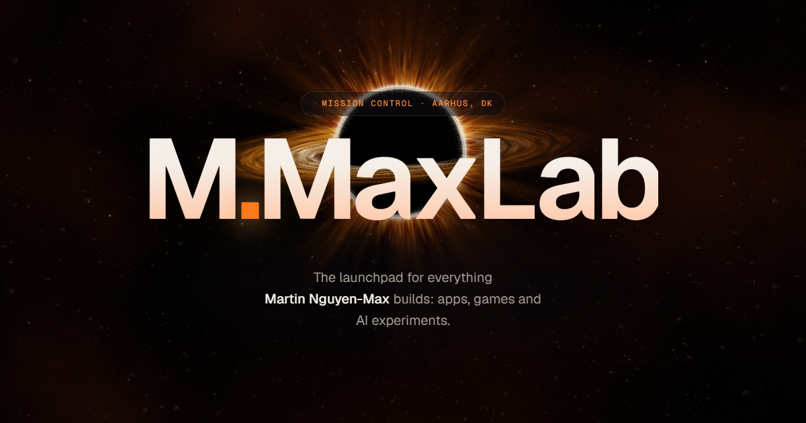

# M.MaxLab

**The launchpad for everything I build.** Apps, games and AI experiments by [MartinNguyen-Max](https://github.com/MartinNguyen-max).

🔗 **[mmaxlab.com](https://mmaxlab.com)**



## Highlights

- **Cinematic scroll.** A hand-written WebGL2 shader (no libraries) renders a black hole with a flowing corona and accretion disk; a meteor smashes it to pieces as you scroll. As you scroll, the camera falls through the event horizon into warp-speed stars, the hole goes supernova, and you land on a small green planet.
- **Zero-JS by default.** Static HTML from Astro 7. Scroll choreography uses native CSS scroll-driven animations (`animation-timeline: view()`), and the only client JS is the shader and small enhancements.
- **Accessible.** Semantic HTML, WCAG 2.2 AA verified with axe in CI (desktop, Android and iPhone/WebKit), full `prefers-reduced-motion` support, and content that never depends on animation.
- **One file per project.** Add a Markdown file and the hub updates. A Zod schema validates it at build time.
- **Drive the portfolio.** A low-poly planet with a rover (three.js, loaded only when you get there). Press Start to play fullscreen: drive up to a project's screen and open it in a new tab. WASD/arrows and drag-to-look on desktop, a joystick on phones, and a plain project list for everyone.
- **Astro View Transitions.** The WebGL canvas persists between pages.

## Tech stack

|           |                                                                                                  |
| --------- | ------------------------------------------------------------------------------------------------ |
| Framework | [Astro 7](https://astro.build) (static output, content collections, Fonts API, View Transitions) |
| Language  | TypeScript (strictest)                                                                           |
| Styling   | Vanilla CSS: design tokens, scoped styles, scroll-driven animations                              |
| Graphics  | Raw WebGL2 fragment shader (background), three.js (planet game, lazy-loaded)                     |
| Quality   | ESLint 10, Prettier, `astro check`, Vitest, Playwright + axe                                     |
| Hosting   | Vercel (+ Web Analytics, cookieless)                                                             |
| CI        | GitHub Actions                                                                                   |

## Getting started

Requires Node.js 22.23+ (see `.nvmrc`) and pnpm.

```sh
pnpm install
pnpm dev
```

| Script                        | What it does                                                           |
| ----------------------------- | ---------------------------------------------------------------------- |
| `pnpm dev`                    | Dev server                                                             |
| `pnpm build` / `pnpm preview` | Static build to `dist/` and serve it                                   |
| `pnpm lint` / `pnpm format`   | ESLint / Prettier                                                      |
| `pnpm check`                  | Type-check `.astro` and `.ts` files                                    |
| `pnpm test`                   | Unit tests (Vitest)                                                    |
| `pnpm test:e2e`               | E2E + accessibility tests (Playwright, axe)                            |
| `pnpm screenshots`            | Capture front-page screenshots of live projects                        |
| `pnpm og`                     | Regenerate `public/og.png` from the real hero (run after `pnpm build`) |

## Adding a project

Create `src/content/projects/my-project.md`:

```yaml
---
name: My Project
tagline: One line that sells it.
description: Two sentences about what it is and why it exists.
status: live # live | in-progress | coming-soon
url: https://my-project.mmaxlab.com
repo: https://github.com/MartinNguyen-max/my-project
image: ../../assets/projects/my-project.png
imageAlt: What the screenshot shows.
tech: [TypeScript, React]
order: 3
---
```

Then run `pnpm screenshots my-project` to capture the image. Live projects get a screen on the planet and a card in the overview. `coming-soon` projects appear in "In the lab".

## Project structure

```text
src/
  components/      UI components (.astro)
  content/projects one Markdown file per project
  layouts/         BaseLayout (SEO, fonts, view transitions, cosmos)
  lib/             pure logic + unit tests
  pages/           routes: /, /about, 404, robots.txt
  scripts/cosmos/  WebGL2 renderer + shader
  scripts/planet/  three.js planet game (world, rover, game loop)
  styles/          tokens + global CSS
scripts/           screenshot and OG image generators
tests/e2e/         Playwright + axe
docs/              spec, decisions, plan, deployment
```

## Docs

- [Specification](docs/SPEC.md)
- [Decisions](docs/decisions.md)
- [Deployment (Vercel + DNS)](docs/deployment.md)

## License

[MIT](LICENSE) © MartinNguyen-Max. Project screenshots and the OG image show my own projects.
