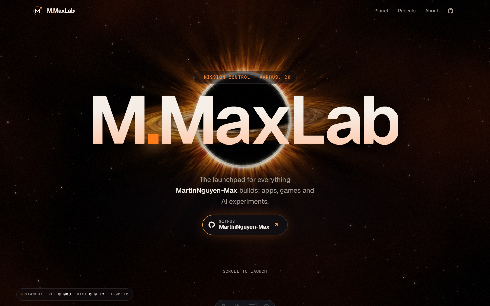
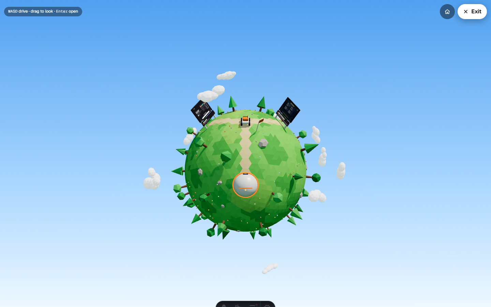

# M.MaxLab

**The launchpad for everything I build.** Apps, games and AI experiments by [MartinNguyen-Max](https://github.com/MartinNguyen-max).

🔗 **[mmaxlab.com](https://mmaxlab.com)**



## What's here

- **A cinematic front page.** A hand-written WebGL2 shader renders a black hole. As you scroll, you fall through it and land on a small planet.
- **A planet you can drive.** Press Start to drive a rover around a low-poly planet and open a project by driving up to its screen.



- **Zero JavaScript by default.** Static HTML, with scripts only for the shader and the game.
- **Accessible.** WCAG 2.2 AA, checked with axe in CI, and `prefers-reduced-motion` respected.

## Tech stack

| | |
| --- | --- |
| Framework | [Astro 7](https://astro.build), static output |
| Language | TypeScript (strict) |
| Styling | Vanilla CSS with design tokens |
| Graphics | Raw WebGL2 shader, three.js for the planet game |
| Tests | Vitest, Playwright + axe |
| Hosting | Vercel |

## Run it locally

Requires Node.js 22.23+ and pnpm.

```sh
pnpm install
pnpm dev
```

`pnpm build` · `pnpm test` · `pnpm test:e2e` · `pnpm check`

## Docs

- [Specification](docs/SPEC.md): what the site is and must do
- [Decisions](docs/decisions.md): why it is built the way it is
- [Plan](docs/plan.md): what is done and what is next
- [Deployment](docs/deployment.md): Vercel and DNS

## License

[MIT](LICENSE) © MartinNguyen-Max. The screenshots show my own projects.
